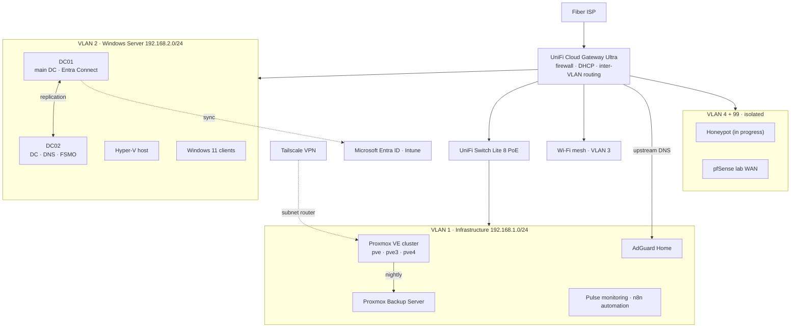

# Home Lab Infrastructure

A self-built hybrid Windows and Linux environment that I design, run and document like a small-business network: a **3-node Proxmox VE cluster**, a **Hyper-V host** running an **Active Directory domain** with **hybrid identity to Microsoft Entra ID and Intune**, a **segmented UniFi network**, filtered DNS, VPN-only remote access and nightly backups.

The documentation is written as an operations handover, the way I'd leave it for another administrator: design, inventory, access model, backup strategy, runbooks and a prioritized remediation roadmap from my own audit.

---

## At a glance

| | |
|---|---|
| **Compute** | 4 physical hosts (3 Proxmox nodes + 1 Hyper-V host): 40 CPU threads, 112 GB RAM, about 3.3 TB of storage |
| **Workloads** | 9 LXC containers and 4 KVM VMs on Proxmox; 6 Hyper-V VMs |
| **Identity** | `corp.example.com` AD domain: 2 Windows Server 2025 DCs, department OUs, AGDLP, GPO, Entra Connect, Intune |
| **Network** | UniFi gateway and switch, 5 VLANs (2 isolated), DHCP reservations, AdGuard DNS filtering |
| **Remote access** | Tailscale mesh VPN with a subnet router; zero inbound ports |
| **Backup** | Proxmox Backup Server with nightly deduplicated jobs and server-side pruning |
| **Tooling** | Read-only PowerShell and Bash inventory scripts, Proxmox REST API, PowerShell Direct |

## Architecture

## Documentation

| # | Section | What's covered |
|---|---|---|
| 1 | [Network](docs/01-network.md) | Topology, VLAN design and isolation, IP plan, DNS path, remote access |
| 2 | [Proxmox VE cluster](docs/02-proxmox-cluster.md) | Nodes, storage, every container and VM, access model |
| 3 | [Hyper-V and Active Directory](docs/03-hyper-v-and-active-directory.md) | Hyper-V host and VMs, AD design, OUs, AGDLP, GPOs, hybrid identity |
| 4 | [Backup and recovery](docs/04-backup-and-recovery.md) | Backup layers, PBS design, retention, known gaps |
| 5 | [Security and operations](docs/05-security-and-operations.md) | Controls, monitoring, change management, audit roadmap |
| 6 | [Runbooks](docs/06-runbooks.md) | Add a guest, restore, onboard a user, domain join, patching, refresh docs |

## Scripts

| Script | Runs on | Purpose |
|---|---|---|
| [`proxmox-inventory.sh`](scripts/proxmox-inventory.sh) | Any Proxmox node | Cluster, storage, backup jobs, per-node network, every guest's config and IPs |
| [`Collect-HyperVInventory.ps1`](scripts/Collect-HyperVInventory.ps1) | Hyper-V host (admin) | Hardware, switches, VMs, VHDX chains, checkpoints, Secure Boot/TPM, integration services |
| [`Collect-DomainInventory.ps1`](scripts/Collect-DomainInventory.ps1) | Hyper-V host (admin) | Uses **PowerShell Direct** to query the DC: domain, forest, FSMO, replication, OUs, groups, GPO links, password policy, DNS, DHCP |

All three are **read-only** and safe to run against production systems.

## Skills demonstrated

**Systems:** Windows Server 2025 · Active Directory DS · Group Policy · DNS · Hyper-V · Proxmox VE (LXC/KVM) · Debian Linux · Docker · Proxmox Backup Server

**Cloud and identity:** Microsoft Entra ID · Entra Connect · Intune (MDM auto-enrollment) · hybrid join · AGDLP · least-privilege service accounts and API tokens

**Networking:** 802.1Q VLANs · network isolation · DHCP reservations · DNS filtering · VLAN-aware bridges · Tailscale subnet routing · RSTP

**Practices:** infrastructure documentation · read-only auditing · risk-ranked remediation planning · change logging · snapshot/checkpoint discipline · backup and restore procedures

**Automation:** PowerShell (including PowerShell Direct) · Bash · Proxmox REST API

