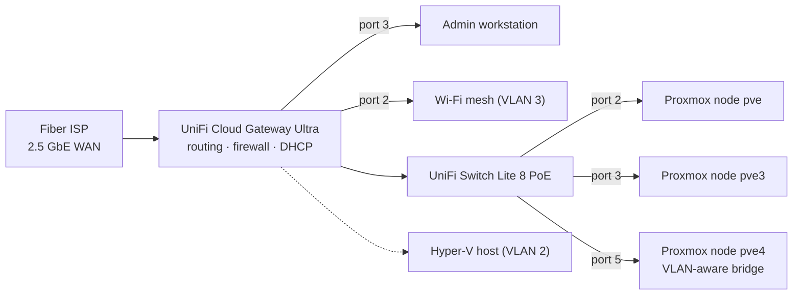
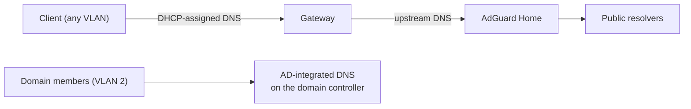

# 1. Network

[← Back to overview](../README.md)

## Topology

| Device | Role |
|---|---|
| UniFi Cloud Gateway Ultra | Edge router, stateful firewall, DHCP server for every VLAN, inter-VLAN routing |
| UniFi Switch Lite 8 PoE | Access switch for the Proxmox cluster; RSTP enabled, rogue DHCP detection on |
| Wi-Fi mesh (2 units) | Wireless access on its own VLAN |

WAN is a single fiber circuit with a second WAN port reserved for failover. UPnP is disabled.

## VLANs

| VLAN | Name | Subnet | Gateway | DHCP pool | Isolated | Purpose |
|---|---|---|---|---|---|---|
| 1 | Default | 192.168.1.0/24 | .1 | .6 to .254 | No | Proxmox nodes, Linux services, wired PCs |
| 2 | Windows Server | 192.168.2.0/24 | .1 | .6 to .254 | No | Hyper-V host, Active Directory, Windows clients |
| 3 | Wi-Fi | 192.168.3.0/24 | .1 | .6 to .254 | No | Wireless clients, security tooling VM |
| 4 | Isolated | 192.168.4.0/24 | .1 | .6 to .254 | **Yes** | Honeypot VM (in progress) |
| 99 | Lab WAN / Honeypot | 192.168.99.0/28 | .1 | .2 to .14 | **Yes** | WAN side of a pfSense lab firewall |

"Isolated" uses UniFi's per-network isolation: hosts on VLAN 4 and VLAN 99 can reach the internet but no other internal network. DHCP guarding is enabled on both isolated VLANs.

VLAN tags reach VMs through a VLAN-aware Linux bridge on Proxmox (`vmbr0` on pve4, guest NICs tagged 2, 3 or 99) and through access-mode VLAN assignment on Hyper-V virtual NICs.

## IP addressing policy

- **Infrastructure** (hypervisors, DNS, monitoring, backup, file services, domain controllers) uses static addresses that are also reserved in UniFi, so DHCP can never hand them out twice.
- **Application services** get DHCP reservations, so addresses survive lease expiry and rebuilds.
- **Clients** use dynamic DHCP from the gateway's pool for their VLAN.
- Low addresses in each subnet are kept outside the DHCP pool for network equipment.

## DNS

- Every DHCP client uses its VLAN gateway for DNS. The gateway's own upstream is AdGuard Home, so all networks are filtered without configuring individual devices.
- Active Directory members resolve `corp.example.com` through AD-integrated DNS on the domain controllers.
- Proxmox nodes use the gateway; the subnet-router node uses Tailscale MagicDNS.

## Remote access

Remote administration uses a **Tailscale** mesh VPN instead of port forwarding, so no inbound ports are open on the firewall.

- One Proxmox node is the **subnet router**, publishing the LAN to authorized tailnet devices.
- MagicDNS and HTTPS certificates are enabled for tailnet hostnames.
- Server nodes have key expiry disabled; user devices keep expiring keys and re-authenticate.
