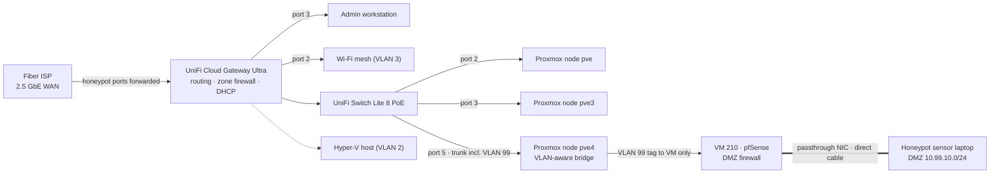
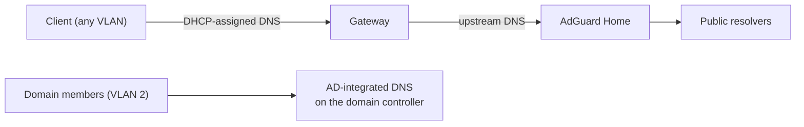

# 1. Network

[← Back to overview](../README.md)

## Topology

| Device | Role |
|---|---|
| UniFi Cloud Gateway Ultra | Edge router, stateful firewall, DHCP server for every VLAN, inter-VLAN routing |
| UniFi Switch Lite 8 PoE | Access switch for the Proxmox cluster; RSTP enabled, rogue DHCP detection on |
| Wi-Fi mesh (2 units) | Wireless access on its own VLAN |

WAN is a single fiber circuit with a second WAN port reserved for failover. UPnP is disabled.

## VLANs

| VLAN | Name | Subnet | Gateway | DHCP pool | Zone | Purpose |
|---|---|---|---|---|---|---|
| 1 | Default | 192.168.1.0/24 | .1 | .6 to .254 | Internal | Proxmox nodes, Linux services, wired PCs, security tooling VM |
| 2 | Windows Server | 192.168.2.0/24 | .1 | .6 to .254 | Internal | Hyper-V host, Active Directory, Windows clients |
| 3 | Wi-Fi | 192.168.3.0/24 | .1 | .6 to .254 | Internal | Wireless clients |
| 99 | DMZ | 192.168.99.0/28 | .1 | .6 to .14 | **DMZ** | WAN side of the pfSense honeypot firewall ([section 7](07-dmz-honeypot.md)) |

Zones come from UniFi's zone-based firewall. Internal VLANs can reach each other; VLAN 99 is in the **DMZ zone**, where explicit policies let the DMZ only reply to internal hosts and let only the admin workstation reach it. DHCP guarding is enabled on the DMZ VLAN. A former isolated VLAN reserved for an earlier honeypot design was retired once the DMZ went live.

VLAN tags reach VMs through a VLAN-aware Linux bridge on Proxmox (`vmbr0` on pve4, guest NICs tagged 2, 3 or 99) and through access-mode VLAN assignment on Hyper-V virtual NICs.

## DMZ traffic path

Honeypot traffic follows a fixed physical path. The sensor is never attached to the switch, and the Proxmox host never holds an address in either DMZ segment. Full design in [section 7](07-dmz-honeypot.md).

| Hop | Device | What happens |
|---|---|---|
| 1 | UniFi gateway | Forwards only the honeypot ports to the pfSense WAN on VLAN 99; DMZ zone policies allow the DMZ to reply to internal hosts but never start a connection inward |
| 2 | Switch, pve4 port | Carries VLAN 99 tagged on the trunk to pve4 |
| 3 | pve4 `vmbr0` | Delivers the VLAN 99 tag to VM 210's WAN NIC only; the host itself has no VLAN 99 interface |
| 4 | VM 210 (pfSense) | NAT to the sensor, Suricata inspection, default-deny and rate-limited egress |
| 5 | Passthrough NIC and direct cable | A dedicated PCIe NIC owned by the VM through VFIO, cabled straight to the sensor; the host kernel never handles DMZ traffic |
| 6 | Sensor laptop | Runs T-Pot; can reach only pfSense's DNS/NTP and the internet on HTTP/HTTPS |

## IP addressing policy

- **Infrastructure** (hypervisors, DNS, monitoring, backup, file services, domain controllers) uses static addresses that are also reserved in UniFi, so DHCP can never hand them out twice.
- **Application services** get DHCP reservations, so addresses survive lease expiry and rebuilds.
- **Clients** use dynamic DHCP from the gateway's pool for their VLAN.
- Low addresses in each subnet are kept outside the DHCP pool for network equipment.

## DNS

- Every DHCP client uses its VLAN gateway for DNS. The gateway's own upstream is AdGuard Home, so all networks are filtered without configuring individual devices.
- Active Directory members resolve `corp.example.com` through AD-integrated DNS on the domain controllers.
- Proxmox nodes use the gateway; the subnet-router node uses Tailscale MagicDNS.

## Remote access

Remote administration uses a **Tailscale** mesh VPN instead of port forwarding, so no inbound ports lead to any internal network. The only port forwards on the gateway carry honeypot traffic to the DMZ firewall ([section 7](07-dmz-honeypot.md)), and the DMZ ranges are not advertised to the tailnet.

- One Proxmox node is the **subnet router**, publishing the LAN to authorized tailnet devices.
- MagicDNS and HTTPS certificates are enabled for tailnet hostnames.
- Server nodes have key expiry disabled; user devices keep expiring keys and re-authenticate.
