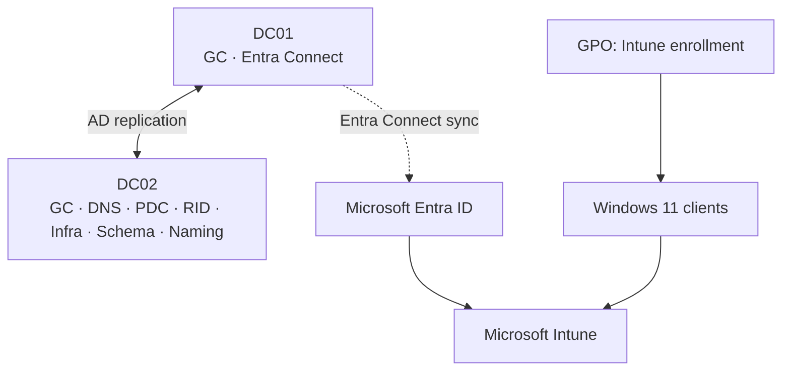

# 3. Hyper-V and Active Directory

[← Back to overview](../README.md)

## Hyper-V host

| Item | Value |
|---|---|
| Hardware | Core i7-10700K (8C/16T), 48 GB RAM, 1 TB SATA SSD, 2.5 GbE |
| OS | Windows 10 Pro 22H2 with the Hyper-V role (past end of support; see the [roadmap](05-security-and-operations.md#audit-and-remediation-roadmap)) |
| Network | External virtual switch bound to the 2.5 GbE NIC, shared with the host |
| Placement | VLAN 2 (Windows Server), static address |
| Other | Enhanced session mode on; VirtualBox and WSL also installed |

### Virtual machines

All five are Generation 2 (UEFI, Secure Boot) on the External Switch.

| Name | Role | OS | vCPU / RAM | Disk |
|---|---|---|---|---|
| DC01 | Main domain controller, Global Catalog, Entra Connect, file server | Windows Server 2025 | 2 / 8 GB dynamic (4 to 16) | 127 GB |
| DC02 | Domain controller, DNS, all FSMO roles | Windows Server 2025 | 1 / 8 GB | 128 GB |
| WS01 | Domain workstation (IT OU) | Windows 11 Business | 2 / 8 GB | 127 GB |
| WS02 | Domain workstation | Windows 11 Pro | 2 / 8 GB | 127 GB |
| WS-TEST | Disposable domain-join test client, reset with checkpoints | Windows 11 | 2 / 8 GB | 80 GB |

Windows 11 VMs have a virtual TPM. Checkpoints are **disabled** on the main DC; named checkpoints ("freshly joined", "pre domain removal") give repeatable starting points for client testing.

## Active Directory design

| Item | Value |
|---|---|
| Domain | `corp.example.com` (NetBIOS `CORP`) |
| Functional levels | Domain: Windows Server 2025. Forest: Windows Server 2016 |
| Domain controllers | 2 writable, both Global Catalogs, replication verified |
| FSMO roles | All five on DC02 |
| Sites | Default-First-Site-Name |



### OU structure

Department OUs, each split into Users and Computers, so user and computer GPOs can be linked separately.

```
corp.example.com
├── Domain Controllers
├── Finance ── Users / Computers
├── HR ─────── Users / Computers
├── IT ─────── Users / Computers
└── Sales ──── Users / Computers
```

### Group strategy (AGDLP)

Permissions are never granted to users directly.

```
Accounts ──► Global role groups ──► Universal group ──► Domain local resource group ──► Permission
             Inside Sales            All Company Sales   Modify Sales DB                 Modify on Sales DB
             Outside Sales
             Sales Support
```

### Group Policy

| GPO | Linked to | Effect |
|---|---|---|
| Default Domain Policy | Domain | Password policy (complexity, history 24, max age 42 days) |
| Default Domain Controllers Policy | Domain Controllers | DC baseline |
| Sign In Warning | IT \ Computers | Legal notice before sign-in |
| Wallpapers | IT \ Users | Standard desktop |
| Intune enrollment | IT \ Computers | Automatic MDM enrollment into Intune |

### Hybrid identity

- **Microsoft Entra Connect** on the main DC synchronizes users to Microsoft Entra ID.
- The tenant's `onmicrosoft.com` domain is registered as an alternate UPN suffix.
- Domain-joined computers in the IT OU become **hybrid Entra joined** and auto-enroll in **Intune** through Group Policy.
