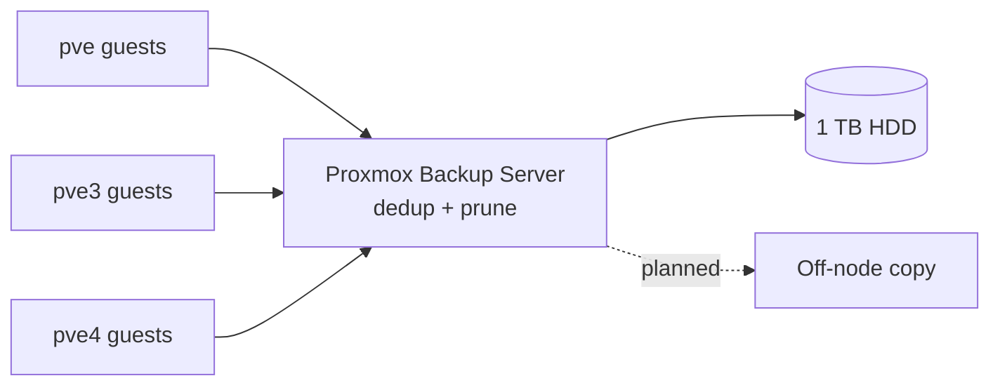

# 4. Backup and recovery

[← Back to overview](../README.md)

## Strategy

| Layer | Method | Frequency | Retention |
|---|---|---|---|
| Proxmox guests | Proxmox Backup Server, snapshot mode, deduplicated | Daily 23:30 | Prune job on the backup server |
| Proxmox test VMs | Manual snapshots before risky changes | As needed | Until merged |
| Hyper-V VMs | Named checkpoints for test clients | As needed | Until merged |
| Notes / documentation | Self-hosted CouchDB sync with end-to-end encryption, plus the Proxmox backup of that container | Continuous | n/a |

## Proxmox Backup Server

| Item | Value |
|---|---|
| Runs as | Container on pve4 |
| Datastore | 700 GB on a dedicated 1 TB HDD (separate from all guest disks) |
| Connection | Dedicated API token; server certificate fingerprint pinned on the cluster |
| Job scope | Every guest by default; the backup server and disposable lab guests are excluded by policy |

## Recovery approach

See [Operations and maintenance: backup verification and recovery](06-maintenance.md#backup-verification-and-recovery).

## Known gaps and plan

- The datastore sits on one disk in one node. **Planned:** an off-node copy through a PBS sync job or an external target.
- Hyper-V VMs are not yet in a scheduled backup. **Planned:** Windows Server Backup on the DCs (system state) and periodic VM export.
- Restore tests will be scheduled quarterly and recorded.
