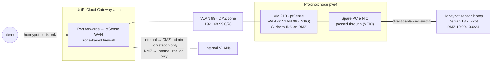

# 7. DMZ honeypot

[← Back to overview](../README.md)

An internet-facing honeypot that collects real attacker activity without giving that traffic any path into the rest of the lab. It runs **T-Pot** (about 20 honeypots, Suricata, and the Elastic Stack with Kibana dashboards) on a **dedicated laptop**, behind a **pfSense firewall VM** that sits in its own **DMZ zone** on the UniFi gateway.

**Status:** live since 2026-11-22, collecting for 30 days; findings will be published at the end.

## Design goals

| Goal | How it is met |
|---|---|
| Capture real attacks from the internet | T-Pot honeypots (SSH/Telnet, web, SMB, databases, RDP, VoIP, ICS and more) behind selected port forwards |
| A compromise must stay contained | The sensor is a separate physical machine; two independent firewall layers; default-deny, rate-limited egress |
| Detection the attacker cannot switch off | Suricata on the pfSense firewall in addition to T-Pot's own Suricata |
| Admin access only from one place | Management ports reachable from a single admin workstation, through both firewalls, by SSH key only |
| Evidence for every control | Each control validated with a documented test before exposure ([Validation](#validation)) |

## Architecture

### Why it is built this way

| Decision | Reasoning |
|---|---|
| **Dedicated hardware, not a VM on the cluster** | pve4 holds the backup server and is a cluster member; Proxmox nodes trust each other's root SSH keys. A VM escape there could reach every node and every backup. A separate laptop keeps a compromise on hardware with nothing else on it |
| **pfSense in front of the sensor** | Gives a second firewall layer, egress control and an IDS that lives outside the attacker's reach, without needing Proxmox on the laptop |
| **PCIe passthrough for the DMZ NIC** | The spare NIC (alone in its IOMMU group) belongs to the pfSense VM through VFIO, so the Proxmox host never drives it and has no IP or IPv6 address on it |
| **Direct cable, no switch** | DMZ traffic never touches the access switch or the gateway, so a switch-port mistake cannot place the honeypot on an internal VLAN |
| **T-Pot on bare metal** | The laptop was upgraded to 16 GB RAM to meet T-Pot's requirements; the alternative (a custom Cowrie + Grafana/Loki stack) fits 8 GB and is kept as a fallback |
| **Detection only (no blocking)** | Blocking attackers after the first alert would stop the data collection. Containment comes from the firewall rules, not the IDS |

## Network and firewall policy

### Segments

| Segment | Subnet | Gateway | Contents |
|---|---|---|---|
| VLAN 99 (UniFi DMZ zone) | 192.168.99.0/28 | UniFi gateway | pfSense WAN (static) |
| Honeypot DMZ (pfSense) | 10.99.10.0/24 | pfSense | Sensor laptop (DHCP static mapping; unknown clients get no lease) |

### UniFi gateway (first layer)

VLAN 99 sits in UniFi's built-in **DMZ zone**. The per-network *Isolate Network* option was turned off deliberately: its built-in block also dropped *replies* from the DMZ to permitted internal hosts. Explicit zone policies do the same job more precisely.

| Direction | Policy |
|---|---|
| Internet → DMZ | Port forwards to the pfSense WAN for the honeypot ports only. Management ports are never forwarded |
| Internal → DMZ | Allow the admin workstation to the pfSense WAN on the management ports; **block everything else** (logged) |
| DMZ → Internal | Built-in zone default: return traffic only; the DMZ can never start a connection inward |
| DMZ → Internet | Allowed (pfSense enforces the real egress policy) |

Intrusion prevention on the gateway is off so attacks are not stopped before they reach the sensor.

### pfSense (second layer)

Rules are evaluated top to bottom on the interface where traffic enters; the first match wins.

**DMZ interface (traffic from the honeypot):**

| # | Action | Destination | Ports | Logged | Purpose |
|---|---|---|---|---|---|
| 1 | Pass | pfSense itself | DNS (53) | – | Name resolution through pfSense's own resolver |
| 2 | Pass | pfSense itself | NTP (123) | – | Time |
| 3 | Block | pfSense itself (all addresses) | any | Yes | The firewall's GUI and services are unreachable from the DMZ |
| 4 | Block | All RFC 1918 ranges | any | Yes | Tripwire: the honeypot must never reach a private address |
| 5 | Pass | Internet | TCP 80, 443 | – | Updates, image pulls, honeypot malware downloads, community data feed. Rate-limited to **10 Mbit/s** each way |
| 6 | Block | any | any | Yes | Default deny, logged |

**WAN interface:** NAT forwards for the honeypot ports to the sensor, and source-restricted forwards from the admin workstation to T-Pot's SSH and web UI. The pfSense GUI listens on a high port outside the forwarded range, reachable from the admin workstation only. The default anti-lockout rule is disabled because it would have allowed the DMZ to reach the GUI.

**Exposed honeypot ports (phase A):** 21-23, 80, 443, 445, 1433, 3306, 3389, 5060, 5900, 6379, 8080, 9200 (TCP/UDP). Phase B widens this to the full range below T-Pot's management ports once the first phase has run cleanly.

### Intrusion detection

| Sensor | Location | Rules | Role |
|---|---|---|---|
| Suricata (pfSense package) | pfSense DMZ interface | ET Open + Snort GPLv2 Community, selected categories (attack response, exploit, malware, coinminer, scan, shellcode, worm, web, DNS, DoS, FTP, Telnet, SQL) | Out of the attacker's reach; sees the honeypot's own outbound traffic, so it catches a successful compromise (C2 beacons, miners, `id` output) |
| Suricata (T-Pot) | On the sensor | ET Open | Feeds the Kibana dashboards alongside honeypot events |

## Sensor build

| Step | Detail |
|---|---|
| Hardware | Spare laptop, 16 GB RAM, 256 GB NVMe, wired gigabit NIC |
| Radios | No BIOS option to disable Wi-Fi/Bluetooth, so the M.2 wireless card was **physically removed** |
| Firmware | Supervisor password, UEFI, Secure Boot on |
| Disk | SSD discarded with `blkdiscard` from a live image and verified (reads back zeros) before install |
| OS | Debian 13 netinst: no desktop, SSH server and standard utilities only; root password locked, admin through `sudo` |
| T-Pot | Standard (Hive) install from the official installer, read before running; SSH moved to T-Pot's management port |
| SSH | Key-only (dedicated ed25519 key on the admin workstation), passwords and root login disabled through an `sshd_config.d` drop-in |
| Community data | T-Pot's community submission kept on, contributing attack events to Deutsche Telekom's Sicherheitstacho early-warning network |

## Validation

Every control was tested before the honeypot was exposed.

| # | Test | Result |
|---|---|---|
| V1 | Internal host (not the admin workstation) → DMZ | Dropped by the UniFi policy; no entry ever reached pfSense's log |
| V2 | Admin workstation → pfSense GUI, T-Pot SSH and web UI | Allowed |
| V3 | Honeypot → pfSense (GUI and port 80), gateway, internal hosts | All blocked and logged |
| V4 | Honeypot → internet | HTTPS works at ~9.5 Mbit/s (limiter confirmed); other ports blocked |
| V5 | pfSense WAN → internal host (DMZ side starting a connection inward) | 100% loss |
| V6 | Inbound honeypot path (internal test host, temporary rules) | Cowrie login and commands logged in Kibana; T-Pot's Suricata flagged the honeypot's deliberately vulnerable-looking OpenSSH banner (CVE-2024-6387 "regreSSHion") |
| V7 | pfSense Suricata | `GPL ATTACK_RESPONSE id check returned root` (SID 2100498) fired on a simulated `id` response |
| V8 | SSH password login to the sensor | `Permission denied (publickey)` |

## Problems found and fixed

Troubleshooting notes from the build, kept because they apply well beyond this project.

| Symptom | Root cause | Fix |
|---|---|---|
| SSH and the web UI timed out from the admin workstation although the firewalls passed the traffic | Docker had run out of its default ranges and created bridge networks in `192.168.0.0/20` and `192.168.96.0/20`. Those routes overlapped the internal LAN and VLAN 99, so replies went into a Docker bridge | Set Docker's `default-address-pools` to `172.16.0.0/12` in `/etc/docker/daemon.json` (validated with `python3 -m json.tool` first, after a missing quote stopped Docker once), pruned the old networks |
| The sensor received a pool address instead of its DHCP reservation after the OS rebuild | Kea tracks leases by client identifier; the new OS's DHCP client sent a different one for the same MAC | Enabled *Ignore Client Identifiers* on the DMZ scope and cleared the stale leases |
| An internal test host's connections to the honeypot hung in `SYN_SENT` | `tcpdump` on both ends plus pfSense's state table showed the sensor answering and pfSense forwarding; the UniFi isolation flag's built-in block dropped the replies on the way back | Turned off per-network isolation for VLAN 99 and relied on explicit zone policies |
| A pfSense rule reorder appeared to do nothing | Dragging rules only takes effect after **Save** under the rule table, then Apply | Saved, applied, and confirmed with each rule's state counters |
| The classic Suricata test URL returned nothing | testmynids.org has expired (parked domain) | Generated the same `uid=0(root)` response through an HTTP echo service instead |
| VLAN 99 broadcasts visible inside a VM on another node | That node's non-VLAN-aware bridge floods all tagged traffic from the trunk to every guest | Logged on the [remediation roadmap](05-security-and-operations.md#audit-and-remediation-roadmap) |

## Operations

| Cadence | Check | Red flag |
|---|---|---|
| Daily | Discord digest (automated, see [Alerting](#alerting)) | Red title, or no digest at all |
| Daily | pfSense firewall log: blocks with the honeypot as **source** | Repeated private-range or unexpected outbound attempts |
| Daily | pfSense Suricata alerts with the honeypot as **source** | C2, coinminer or malware traffic from the sensor itself |
| Weekly | pfSense memory; limiter throughput; data export for the write-up | Memory near 100% |

### Alerting

Two scripts on the sensor post to a dedicated Discord channel ([source and install](../scripts/honeypot-alerting/)). They run under systemd timers as a throwaway unprivileged user, receive the webhook URL as a systemd credential, and treat every attacker-controlled string as hostile (no mentions, no formatting breakouts, defanged URLs).

| Alert | Speed | Trigger |
|---|---|---|
| 🔴 Real SSH activity on the sensor | ≤ 5 min | Any login or connection on the real SSH port from an address other than the admin workstation |
| 🔴 Sensor-initiated IDS alert | ≤ 5 min | A Suricata alert on a connection the sensor started (to port 80/443) with no Cowrie download at that time |
| 🟠 Likely payload fetch | ≤ 5 min | The same, but within three minutes of a Cowrie download: the honeypot collecting a sample |
| 🟠 Silent pipeline / disk | ≤ 5 min | No honeypot attacks for 60 minutes, or the disk above 85% |
| Daily digest | 08:00 | Attacks by honeypot, top sources, countries, credentials, commands, new malware hashes, top signatures. Doubles as a heartbeat |

**Tuning lessons:** honeypot services *reply* to attackers, so a naive "alerts from the sensor" rule fires constantly (Cowrie's Telnet "login incorrect" matches a classic signature). Sensor-initiated traffic is therefore defined by the egress policy: only connections from the sensor to ports 80/443 count. Suricata also logs ordinary TLS and flow records, so only `event_type: alert` documents are considered, and passive fingerprinting events (p0f, fatt) are excluded from attack totals.

**Limits:** a full compromise of the sensor could stop these timers; the missing daily digest and the independent Suricata on pfSense cover that case. The pfSense firewall log is not forwarded yet and is checked by hand.

**Kill switch** (fastest first): disable the pfSense DMZ interface, pause the UniFi port forward, or unplug the DMZ cable. The sensor stays powered so its memory can be examined; after any sign of a real compromise it is wiped and rebuilt from this page.

**Data handling:** collected data is pulled to the admin workstation, never pushed from the sensor. Test traffic from internal addresses is excluded from all statistics. Published screenshots are cropped to remove the public IP and the map location of the sensor.

## Next steps

- 30-day findings: sessions and unique sources, top credentials, commands, malware hashes, top Suricata signatures, all mapped to MITRE ATT&CK (for example T1110.001 Password Guessing, T1059.004 Unix Shell, T1105 Ingress Tool Transfer, T1496 Resource Hijacking).
- Phase B port range once phase A has run cleanly.
- Automated containment: n8n polls the sensor's health and, on a high-confidence compromise signal, pauses the pfSense VM through a Proxmox API token limited to that VM's power controls. Medium-confidence alerts wait for manual approval.
- Forward pfSense firewall and Suricata logs to a log host on the internal network through a single one-way pinhole.
